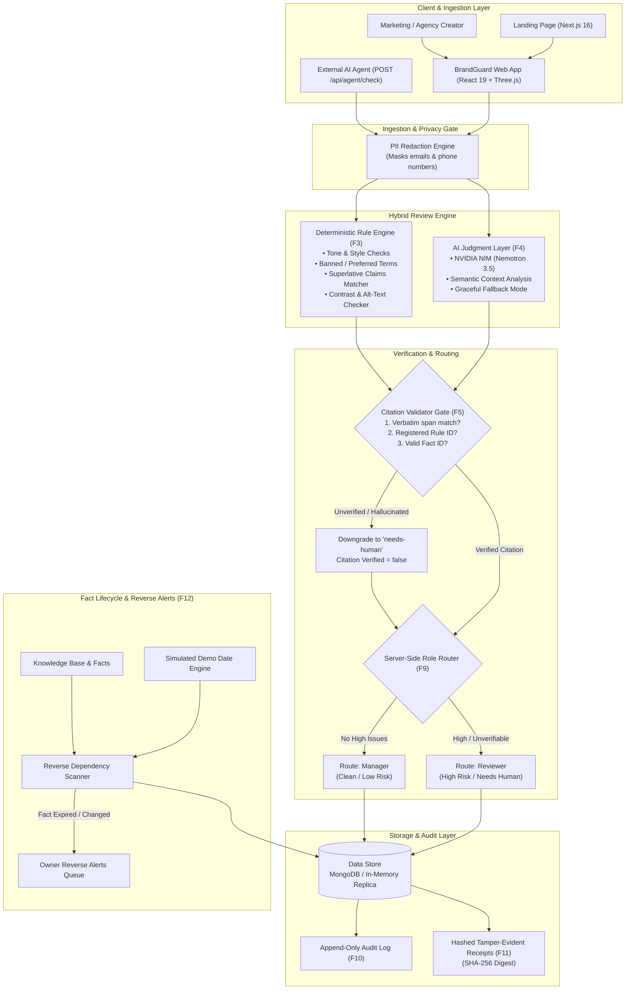

# BrandGuard 🛡️

[](LICENSE)
[](brandguard-app/test)
[](https://nodejs.org/)
[](https://brandguard-vy9i.onrender.com)

> **Pre-publication brand governance platform**: citation-grounded hybrid review engine, automated fact expiry & reverse alerts, SHA-256 hashed tamper-evident approval receipts, and real-time operational insights.

---

## 🌐 Live Deployments

- **Live Application & Dashboard:** [https://brandguard-vy9i.onrender.com/#/dashboard](https://brandguard-vy9i.onrender.com/#/dashboard)
- **Product Landing Page:** [https://brand-1guard.netlify.app](https://brand-1guard.netlify.app)
- **GitHub Repository:** [https://github.com/krrish2803/BrandGuard](https://github.com/krrish2803/BrandGuard)

---

## 📖 Overview

Fast-moving creative, marketing, and agency teams produce massive volumes of copy across email, social, web, and print. Brand guidelines today live in static PDFs that creators ignore and humans struggle to police at scale. Generic AI solutions hallucinate rules, fabricate citations, and lack legal accountability.

**BrandGuard** solves pre-publication brand governance through an accountable, hybrid architecture:
1. **Deterministic Rule Engine + NVIDIA NIM AI Evaluation:** Rapid heuristic pattern matching combined with high-reasoning LLMs.
2. **Citation Validator (F5):** An uncompromising verification gate. Any AI finding that cites an unapproved rule, references a non-existent fact, or highlights text not verbatim in the source is rejected and downgraded to `needs-human`.
3. **Automated Reverse Alerts (F12):** When a fact expires (or an offer changes from 20% to 25%), BrandGuard retroactively identifies every approved or scheduled campaign that now claims something false, notifying owners before publication.
4. **Hashed, Tamper-Evident Receipts (F11):** Every sign-off generates a SHA-256 cryptographic digest of the exact content, rule versions, and reviewer identity.
5. **Insights Dashboard (F13):** Real-time metrics on most-broken rules, workflow bottlenecks, fact health, and AI utilization.

---

## 🏗️ System Architecture



---

## ⚡ Core Features

| Feature ID | Name | Capability & Implementation |
| :--- | :--- | :--- |
| **F1** | **Brand Knowledge Base** | Central repository storing brand tone rules, terms glossary, approved claims, approved facts, color palettes, and competitor lists. |
| **F2** | **Multi-Channel Intake** | Ingestion of raw text, rich campaign copy, and visual asset metadata across Email, Social, Web, and Print channels. |
| **F3** | **Deterministic Checks** | Zero-latency AST and regular expression evaluation checking punctuation counts, capitalization, banned vocabulary, and accessibility. |
| **F4** | **AI Judgment (NVIDIA NIM)** | Deep contextual evaluation using `nvidia/nemotron-3.5-bolt-e4b`. Automatically falls back to deterministic checks if keys are absent. |
| **F5** | **Citation Validator** | Strict verification gate: checks that every cited rule/fact exists and highlights a verbatim substring. Non-compliant citations are downgraded to `needs-human`. |
| **F6 & F7** | **Explained Findings & Fixes** | Human-readable violation summaries paired with verifiable replacement suggestions. |
| **F8** | **Human Decision Interface** | Content workflow allowing creators and reviewers to `Accept`, `Edit`, or `Dispute` (with required rationale) any finding. |
| **F9** | **Server-Side Role Enforcement** | Strict RBAC: Reviewer vs Manager permissions enforced on the backend. Unauthorized sign-offs return `403 Forbidden` and log a blocked attempt. |
| **F10** | **Append-Only Audit Log** | Comprehensive, chronological record of all reviews, approvals, disputes, role violations, and reverse alerts. |
| **F11** | **Approval Receipts** | SHA-256 hashed, tamper-evident certificate linking approved content to the exact rule versions and reviewer credentials at sign-off. |
| **F12** | **Reverse Alerts & Expiry** | Proactive scanner: editing a fact or passing a demo expiry date identifies affected scheduled/approved collateral and generates alerts for owners. |
| **F13** | **Insights Analytics** | Dashboard showcasing top 8 violated rules, workflow queues, fact health countdowns, AI vs rule breakdown, and issue distribution. |
| **F14** | **Privacy & AI Disclosure** | Transparent disclosure endpoint detailing client-side PII scrubbing (emails, phone numbers) and data persistence policies. |
| **F15** | **External Agent API** | Machine-to-machine endpoints (`/api/agent/check`, `/api/agent/context`) allowing 3rd-party bots to run citation-grounded reviews. |
| **F18** | **Health & Graceful Degradation** | Hard request abort timeouts (60s), memory-to-Mongo dual storage drivers, and deterministic offline fallbacks. |

---

## 📂 Repository Structure

```
.
├── brandguard-app/                  # Core governance platform & Express API
│   ├── client/                      # React 19 + Three.js frontend (Vite)
│   ├── public/                      # Compiled frontend assets & app entry
│   ├── server/                      # Express 5 backend API & storage drivers
│   │   ├── index.js                 # API routes & server initialization
│   │   ├── store.js                 # Unified Mongo & Memory storage adapter
│   │   ├── seed.js                  # Pre-seeded brand guidelines & facts
│   │   └── ai.js                    # NVIDIA NIM / LLM integration layer
│   ├── src/                         # Pure review engine (zero external dependencies)
│   │   ├── engine.js                # Core review pipeline orchestrator
│   │   ├── validator.js             # F5 Citation Verification Gate
│   │   └── factscan.js              # F12 Reverse Alert Scanner
│   └── test/                        # Vitest test suite (116 hermetic tests)
│
├── brandguard-landing/              # Next.js 16 product landing page
│   ├── src/                         # Client components, 3D Canvas scenes & styling
│   └── next.config.mjs              # Static HTML export configuration
│
├── BrandGuard_Round1_Submission.pdf # System design & architectural blueprint
├── BrandGuard_Round2_Build_Spec.pdf # Build requirements specification
├── LICENSE                          # MIT Open Source License
└── README.md
```

---

## 🚀 Getting Started

### Prerequisites
- **Node.js:** v20.0.0 or higher
- **npm:** v10.0.0 or higher
- *(Optional)* **MongoDB:** If omitted, BrandGuard runs automatically on an internal in-memory database replica.
- *(Optional)* **NVIDIA API Key:** Set `NVIDIA_API_KEY` for live LLM checks. If omitted, BrandGuard runs deterministic checks with zero degradation.

---

### Local Installation & Running

#### 1. Clone the Repository
```bash
git clone https://github.com/krrish2803/BrandGuard.git
cd BrandGuard
```

#### 2. Start BrandGuard App (Backend + Client)
```bash
cd brandguard-app
npm install

# Run the 116-test hermetic test suite
npm test

# Run the interactive CLI demo walkthrough
npm run demo

# Start the application server on http://localhost:4000
npm start
```

Visit **`http://localhost:4000`** in your browser to access the live BrandGuard dashboard.

#### 3. Start the Landing Page (Optional)
```bash
cd ../brandguard-landing
npm install
npm run dev
```
Visit **`http://localhost:3000`** to view the interactive 3D landing page.

---

## 🧪 Testing & Quality Assurance

BrandGuard features **116 automated hermetic tests** covering the pure engine, REST API, citation validator, role security, and 3D visual graph:

```bash
cd brandguard-app
npm test
```

### Test Breakdown:
- **`test/engine.test.js` (43 tests):** Validates deterministic rules, banned terminology, superlative claims verification, and F5 citation gate rejection of fabricated citations.
- **`test/api.test.js` (48 tests):** Comprehensive coverage of Express endpoints, session management, role routing (403 forbidden on unauthorized approvals), and reverse alert generation.
- **`test/constellation.test.js` (15 tests):** Validates 3D guideline constellation graph positioning, node connectivity, and color cluster calculations.
- **`test/ai.test.js` (10 tests):** Verifies live/mocked NVIDIA NIM responses, citation validation downgrades, and deterministic fallback integrity.

---

## 📡 API Reference

BrandGuard exposes a clean REST API:

### Review & Content Endpoints
- `POST /api/review` — Submits copy for multi-channel evaluation (deterministic + AI + F5 validator).
- `GET /api/contents` — Lists all submitted, reviewed, and approved collateral.
- `GET /api/contents/:id` — Retrieves content details, version history, and finding decisions.
- `POST /api/contents/:id/submit` — Submits draft copy into review queue.
- `POST /api/contents/:id/decision` — Accepts, edits, or disputes findings (role-gated).
- `POST /api/contents/:id/approve` — Grants final sign-off and generates approval receipt (role-gated).
- `GET /api/contents/:id/receipt` — Retrieves SHA-256 hashed, tamper-evident sign-off receipt.

### Knowledge Base & Reverse Alerts
- `GET /api/kb` — Fetches active brand rules, claims, facts, glossary, and current demo date.
- `PUT /api/facts/:id` — Updates fact value/validity; automatically triggers F12 reverse scan.
- `POST /api/settings/demo-date` — Advances the demo date to simulate fact expirations in real time.
- `GET /api/alerts` — Retrieves active reverse alerts grouped by department owner.
- `POST /api/alerts/:id/ack` — Acknowledges an active alert.

### Governance, Audit & Insights
- `GET /api/insights` — Returns real-time metrics for all 5 dashboard panels.
- `GET /api/audit` — Queries the append-only operational audit log.
- `GET /api/ai/disclosure` — Details data protection, PII redaction, and model configurations.
- `GET /api/health` — Verifies server health, uptime, and storage mode (`memory` or `mongodb`).

### External Integrations (Agent API)
- `POST /api/agent/check` — Allows external tools/bots to check text with citation grounding.
- `GET /api/agent/context` — Provides external agents with current brand rules and approved facts.

---

## 🔒 Security & Privacy

1. **PII Masking:** Email addresses and phone numbers are scrubbed client-side and server-side before copy is ever transmitted to an LLM.
2. **Append-Only by Design:** The audit log does not expose delete or update methods. Every decision, role escalation, and system event is permanently recorded.
3. **Cryptographic Integrity:** Approval receipts combine content hash, rule version metadata, reviewer timestamps, and reviewer IDs into an immutable SHA-256 record.

---

## 📄 License

This project is open-source and licensed under the **[MIT License](LICENSE)**.
